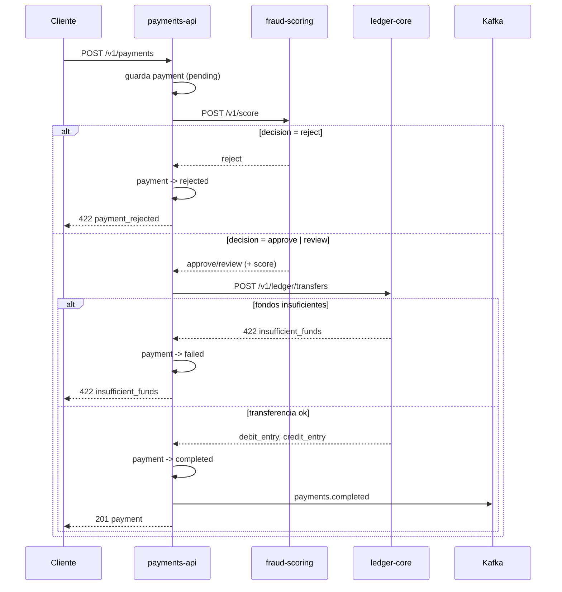

# payments-api

Orquesta transferencias entre cuentas y cobros de comercios. Es el servicio con más tráfico de
Cauri, así que lo tratamos con más cuidado que al resto: tests por cada rama del flujo, ADRs para
las decisiones que importan, changelog, y (todavía) un endpoint viejo que alguien no terminó de
migrar.

Somos el equipo **payments**. Dueños del código: Tomás Vidal, Lucía Benítez, Diego Paz.

## Qué hace

Un pago pasa por tres sistemas antes de existir:

1. **fraud-scoring** decide si lo dejamos pasar.
2. **ledger-core** mueve la plata de una cuenta a otra.
3. **Kafka** avisa al resto de la organización que el pago se completó.

Si fraud-scoring dice `reject`, cortamos ahí: el pago queda `rejected` y devolvemos `422
payment_rejected`. Si dice `review`, igual seguimos — solo que guardamos el `fraud_score` para que
alguien lo pueda mirar después. Si el ledger no tiene fondos, el pago queda `failed` con `422
insufficient_funds`. Solo publicamos el evento cuando el pago llega a `completed`.



`POST /v1/merchants/{id}/charges` es el mismo flujo con `to_account` = la cuenta del comercio y
`merchant_id` seteado.

## Corriendo local

Necesitás Postgres (`payments`), Kafka y Keycloak accesibles — en el cluster de desarrollo ya están
en `platform`. Con eso:

```bash
export SERVICE_NAME=payments-api ENV=staging PORT=8080 LOG_LEVEL=INFO
export DB_HOST=localhost DB_NAME=payments DB_USER=cauri DB_PASSWORD=cauri
export KEYCLOAK_ISSUER=http://localhost:8180/realms/cauri-staging
export KEYCLOAK_CLIENT_ID=payments-api KEYCLOAK_CLIENT_SECRET=<secret del client>
export KAFKA_BOOTSTRAP=localhost:9092 KAFKA_TOPIC_PREFIX=staging.
export LEDGER_CORE_URL=http://localhost:8081 FRAUD_SCORING_URL=http://localhost:8082

./gradlew bootRun
```

Las migraciones de Flyway (`src/main/resources/db/migration`) corren solas al arrancar; no hace
falta ningún paso manual, ni siquiera para los dos merchants semilla de `V2__merchants_seed.sql`.

## Tests

```bash
./gradlew test
```

`PaymentServiceTest` cubre el flujo completo con los clientes mockeados (aprobado, rechazado,
revisión, fondos insuficientes, cobro a comercio). `PaymentsControllerTest` prueba el endpoint
deprecado y la autenticación.

## Deployments

**No se deploya desde acá.** El pipeline es GitOps: `build.yml` buildea la imagen, la pushea a
`ghcr.io/demo-org-np-migration/payments-api` y bumpea el tag en el repo `gitops`
(`apps/payments-api/values-staging.yaml` en cada push a `main`, `values-prod.yaml` cuando taggeamos
`v*`). Argo CD ve el cambio en `gitops` y sincroniza. Si algo no levantó, no es este repo el que
hay que mirar primero — es el estado de la app en Argo CD. Ver [ADR-001](docs/adr/ADR-001-gitops.md)
para el porqué.

El chart vive en `chart/`. Sus `values.yaml` son los defaults de staging; los valores reales de cada
entorno están en `gitops/apps/payments-api/`, no acá.

## Deprecations

`GET /v1/payments/{id}/status` está deprecado. Se elimina el **2026-10-01**. Devuelve los headers
`Deprecation`, `Sunset` y `Link` apuntando al reemplazo (`GET /v1/payments/{id}`, que trae el mismo
dato adentro de `status` más todo lo demás).

Los consumidores conocidos ya migraron a `GET /v1/payments/{id}`.

Si ves el warning `deprecated endpoint called` en los logs cerca de la fecha de sunset, es una señal
de que alguien no migró — avisar en `#payments` antes de sacarlo.

## Variables de entorno

Ver `chart/values.yaml` para los defaults y las convenciones internas de API para el detalle de cada una:
`SERVICE_NAME`, `ENV`, `PORT`, `LOG_LEVEL`, `DB_HOST`, `DB_NAME`, `DB_USER`, `DB_PASSWORD`,
`KEYCLOAK_ISSUER`, `KEYCLOAK_CLIENT_ID`, `KEYCLOAK_CLIENT_SECRET`, `KAFKA_BOOTSTRAP`,
`KAFKA_TOPIC_PREFIX`, `LEDGER_CORE_URL`, `FRAUD_SCORING_URL`.

## Changelog

Ver [CHANGELOG.md](CHANGELOG.md).
